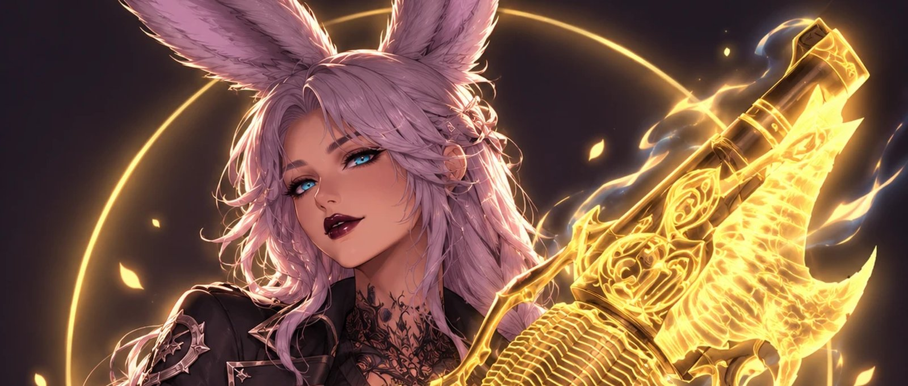

<!-- Badges are static so they work while the repo is private. Update version and last update on each release. -->
<div align="center">

# BunnyRotationReborn

<a href="RotationSolver/Changelog/changelog.json"></a>


<a href="https://github.com/FFXIV-CombatReborn/RotationSolverReborn"></a>
<a href="COPYING.LESSER"></a>



</div>

**BunnyRotationReborn (BRR)** is Bunny's fork of [RotationSolverReborn](https://github.com/FFXIV-CombatReborn/RotationSolverReborn), tuned for high-end and ultimate content.

It reads the fight every frame and works out the best next action for your job: heals, interrupts, mitigation, MP management and damage. It can highlight that action on your hotbar or press it for you. Everything the original plugin does is still here; this fork adds faster input handling and ultimate-specific tuning on top.

> BRR does not do mechanics for you. In Savage and Ultimate, keep your own mitigation and movement on hand.

> [!IMPORTANT]
> **AI was used in the development of this code.** Parts of this fork, including the instant-action, instant-raise and per-ultimate rotation changes, were written with the help of an AI coding assistant. Review the changes and test them yourself before relying on them in progression.

The [ten-job source review](docs/High_End_Rotation_Review.md) records fixes, remaining problems and required game tests. The rotations are not yet validated for every Savage/Ultimate encounter.

> [!TIP]
> **Please support the official release and its developers.** BunnyRotationReborn only exists because of the work of the [RotationSolverReborn](https://github.com/FFXIV-CombatReborn/RotationSolverReborn) team. If you find this useful, please support them on [Ko-fi](https://ko-fi.com/ltscombatreborn), join their [Discord](https://discord.gg/r9V4RHYt6v) and consider using the official release.

## What's different from RotationSolverReborn

### Bunny theme
The whole interface is redesigned around the bunny artwork: dark plum windows with a gold glow edge, the art faded into every page header with twinkling gold sparkles, page titles in the Cinzel display font, and the bunny in a glowing gold ring above the menu with the BunnyRotation wordmark.

- **Home** is a dashboard: switch Auto / Manual / Target only / Off right on the header art, then cards for your autorotation state (with AutoBurst, No pre-pull and Instant raise switches), the next action with a gold GCD bar, the current duty and its ultimate settings, click-to-copy `/bsr` macros, and support links.
- **Every window** (settings, autorotation bar, next action, control window, ultimate settings) uses the Bunny palette: plum surfaces, Bunny Gold highlights, bunny pink secondary accents and moonlit cyan info.
- Teaching mode highlights your hotbar in gold.

Settings: *"Bunny theme"* on the UI page (on by default) turns the whole look off again. The accent colour presets (Bunny Gold, Ember, Bunny Pink, Lavender, Moonlit Cyan, Berry, Crimson) still work; plum surfaces stay while the accent drives buttons and highlights. The Cinzel font is included under the SIL Open Font License (`RotationSolver/Fonts/Cinzel-OFL.txt`).

### Instant actions
- **Your manual action goes first.** BRR tries your spell, weaponskill or ability immediately with its original target and native arguments. If only the current cast, GCD or animation lock prevents it, the rotation yields the next legal action slot to your latest press, then resumes after the game accepts it. A queued solver action cannot take that slot, and automatic heal-cancellation rules leave a manual cast alone. This also works when legacy interception is off.
  Setting: *"Prioritize manual button presses"*, on the Auto page (on by default). It does not bypass game restrictions or cancel a cast already in progress. Invalid, expired or long-cooldown requests are discarded; there is no list of delayed presses. See [behavior and validation](docs/Manual_Input_Priority.md).
- **Legacy instant/interception modes.** Disabling manual priority retains the older instant-press/interception settings, including their command-action fallback for refused presses. The new manual-priority option is the default and does not require legacy interception.
- **Instant raise in high-end duties.** Healers and Summoner skip the random raise delay in Savage, Extreme and Ultimate, and weave Swiftcast in the first free oGCD slot so the raise lands on the next GCD.
  Setting: *"Instant raise in high-end duties"*, in the healing options on the Auto page (on by default).

### Per-ultimate settings (Machinist, Bard, Dancer)
These live in their own window so the normal rotation options stay short. Open the job's rotation options and click **Ultimate settings**. The window has a **Use per-ultimate settings** switch at the top and one tab per ultimate. If you are inside an ultimate, its tab opens first.

| Ultimate | Code |
| --- | --- |
| The Unending Coil of Bahamut | UCoB |
| The Weapon's Refrain | UwU |
| The Epic of Alexander | TEA |
| Dragonsong's Reprise | DSR |
| The Omega Protocol | TOP |
| Futures Rewritten | FRU |
| Dancing Mad | DMU |

For each ultimate you can set:
- **Use potion in the opener.**
- **Hold 2-minute burst when downtime is imminent.** Uses [BossMod Reborn](https://github.com/FFXIV-CombatReborn/BossmodReborn)'s timeline, so it only works with BossMod Reborn installed.
- **Max seconds to hold 2-minute burst for party raid buffs** (Machinist and Bard). If your burst is ready but no other party member's raid buff is up yet, BRR waits up to this long so the windows stack. It never holds during the first 20 seconds of a pull. Set it to 0 to never hold. Dancer doesn't have this: Technical Finish only applies after the dance, so waiting before starting it would push it later.

Extra party/downtime holds only run when *"Allow extra automatic ranged burst holds"* is enabled on the Auto page. That option defaults off. The per-ultimate tabs retain their tuning values (potion on, downtime hold on, 3 second party hold for Machinist/Bard) for users who opt in. Tune them per fight.

### No pre-pull
Nothing automatic happens while a countdown is running, even after a wipe: dances, motifs, Eukrasia, Soulsow, casts, Reassemble and potions all wait. In Savage, Extreme and Ultimate nothing automatic happens out of combat at all until the countdown reaches 0 or the pull starts. In dungeons, AutoDuty and the overworld, out-of-combat behaviour (pulling, raises, stances) is unchanged apart from countdowns. Manual presses remain native.

Eligibility begins at zero, subject to game restrictions and framework updates. Guide openers that assume prepull preparation need an adapted timeline, especially for Dancer and Pictomancer. This does not undo a cast or native action already submitted before the timer began. See the review for cancellation behavior and game tests.
Setting: *"Never act during a countdown (no pre-pull)"*, next to AutoBurst on the Auto page (on by default). Turn it off to get the original pre-pull behaviour back.

### Hold/release burst macros
Macros are optional. AutoBurst and individual action toggles keep their existing controls. When AutoBurst returns, the job resumes its normal priorities and legal weave/GCD windows. Extra automatic party/downtime holds are off by default. If you opt into those holds, the release option below can bypass them for up to 60 seconds after AutoBurst is restored; it does not skip a dance or the game's action restrictions. Recovery cases still requiring validation are listed in the review.
Setting: *"Burst immediately when AutoBurst is turned back on"*, next to AutoBurst on the Auto page (on by default).

### Rotation changes
- **Machinist:** Opener potion in the first weave after the pull (or -2s if pre-pull is turned back on), Reassemble charges and Double Check/Checkmate saved for raid buffs (spent freely in Wildfire, Overheat or right before downtime), per The Balance. Reassemble is used on Drill as well as the other tools. Queen follows The Balance battery plan, keeps cycling it after the opener, resyncs after deaths or downtime and resets every pull; it isn't summoned within 14s of downtime (Queen lasts 12s). If Barrel Stabilizer drifts away from Wildfire, Wildfire is paired with a Hypercharge window instead so it still lands six hits. Tactician and Dismantle are no longer held back during burst.
- **Bard:** Apex Arrow by about 21s left in Mage's Ballad. Three-stack Pitch Perfect goes before Empyreal Arrow so repertoire never overcaps. Battle Voice, Radiant Finale and Raging Strikes respect the burst hold without blocking Bard's other oGCDs. Troubadour is no longer held back during burst by default.
- **Dancer:** Opens with Standard Step at 0 (with pre-pull turned back on: Standard Step at -15s, potion at -1.5s and Standard Finish at -0.5s), Tillana held until 30 Esprit or less, Saber Dance at 80 Esprit outside burst, and Standard Step held when Technical Step is within 6s, per The Balance. Last Dance is always used before Finishing Move or a new Standard Finish can replace it, and before it expires. Tillana can still go out on its last GCD even above 50 Esprit. Technical Step, Devilment and the potion respect the downtime hold. Shield Samba is no longer held back during burst by default.

## Features
- **Full autorotation** for every combat job, including healing, mitigation, duty actions and mechanic-specific behaviour.
- **Teaching mode** that highlights the next action on your hotbar, so you can learn a rotation hands-on.
- **Customisable settings** per job, per encounter type and per boss mechanic.
- **BossMod Reborn integration** for timeline-aware mitigation and burst decisions.

## Installing

BunnyRotationReborn is not on a plugin repository yet, so build it and load it as a dev plugin. Run these in PowerShell.

1. Install the .NET 10 SDK, then close and reopen PowerShell:
   ```powershell
   winget install Microsoft.DotNet.SDK.10
   ```
2. Get the code:
   ```powershell
   git clone https://github.com/heeralaljrahul/RotationSolverReborn.git
   cd RotationSolverReborn
   ```
3. Download the Dalamud reference libraries the build compiles against (one time):
   ```powershell
   $dalamud = "$env:USERPROFILE\dalamud-dev"
   New-Item -ItemType Directory -Force $dalamud | Out-Null
   Invoke-WebRequest https://goatcorp.github.io/dalamud-distrib/latest.zip -OutFile "$env:TEMP\dalamud.zip"
   Expand-Archive "$env:TEMP\dalamud.zip" -DestinationPath $dalamud -Force
   ```
4. Build:
   ```powershell
   $env:DALAMUD_HOME = "$env:USERPROFILE\dalamud-dev\"
   dotnet build RotationSolver\RotationSolver.csproj -c Release -p:Platform=x64 "-p:SolutionDir=$PWD/"
   ```
   The plugin is written to `bin\Release\RotationSolver.dll` inside the repository.
5. In game, type `/xlsettings`, open the **Experimental** tab, paste the full path to `bin\Release\RotationSolver.dll` into **Dev Plugin Locations**, click **+**, then **Save**.
6. Open `/xlplugins`, go to **Dev Tools → Installed Dev Plugins** and enable **BunnyRotationReborn**.

To update later, run `git pull`, repeat step 4, and reload the plugin from **Installed Dev Plugins**.

> Disable the original Rotation Solver Reborn before enabling BRR. They share the same internal name, the `/rotation` command and settings file, so only one can run at a time.

### Version numbers
The version (currently **7.5.7.6**) shows as a gold pill under the menu wordmark and next to every page heading; click it for what's new. To release a new version, bump `<Version>` in `Directory.Build.props`, add a matching entry at the top of `RotationSolver/Changelog/changelog.json`, and update the version and last update badges at the top of this README.

## Commands

| Command | What it does |
| --- | --- |
| `/bsr` or `/rotation` | Open the settings window |
| `/rotation Auto` | Autorotation on, BRR picks targets. Run again to cycle targeting rules |
| `/rotation Manual` | Autorotation on, you pick targets |
| `/rotation TargetOnly` | BRR picks targets, you press the buttons |
| `/rotation Off` | Turn BRR off |

`/bsr` works anywhere `/rotation` does, for example `/bsr Auto` or `/bsr Off`. The original `/rsr` shortcut has been replaced by `/bsr`.

Right-click any setting in the settings window to get its chat command for macros.

## Compatibility notes

BRR keeps the original plugin's internal name (`RotationSolver`), the `/rotation` command and IPC names. This is deliberate: BossMod Reborn, AutoDuty and other plugins talk to it by those names, so they keep working with BRR unchanged.

## Credits and license

BunnyRotationReborn is maintained by **Bunny**.

It is built on [RotationSolverReborn](https://github.com/FFXIV-CombatReborn/RotationSolverReborn) by the CombatReborn team and its contributors. All of the original work is theirs. **Please support the official release and its developers** on [Ko-fi](https://ko-fi.com/ltscombatreborn).

AI was used in the development of this fork's changes.

Licensed under the GNU Lesser General Public License v3. See [COPYING](COPYING) and [COPYING.LESSER](COPYING.LESSER).

Use of third-party plugins is against the FINAL FANTASY XIV Terms of Service. Use at your own risk.
